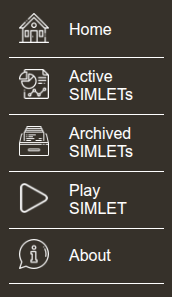
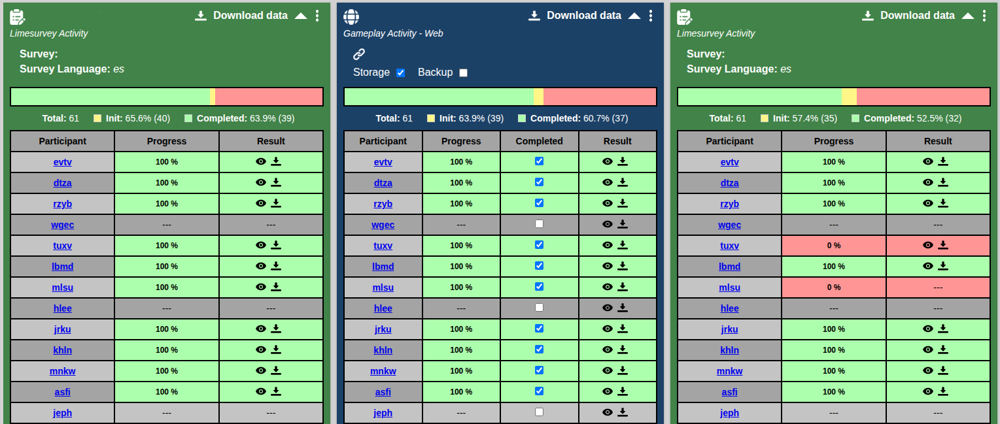

# <%= t("about.title", { ns : "about" }) %>
<%= t("about.description", { ns : "about" }) %>
<br><br>
<%= t("about.description.note", { ns : "about" }) %>

<hr>

## <%= t("about.index.title", { ns : "about" }) %>
<%_ if (!user) { _%>
- [<%= t("about.header_visitors.title", { ns : "about" }) %>](#header-visitor-section)
<%_ } else { _%>
- [<%= t("about.header_user.title", { ns : "about" }) %>](#header-user-section)
- [<%= t("about.left_menu.title", { ns : "about" }) %>](#left-menu-section)
<%_ } _%>
- [<%= t("about.simva.title", { ns : "about" }) %>](#simva-section)
- [<%= t("about.simlet.title", { ns : "about" }) %>](#simlet-section)
- [<%= t("sessions.title.single", { ns : "sessions" }) %>](#session-section)
- [<%= t("activities.title.single", { ns : "activities" }) %>](#activity-section) 
- [<%= t("users.title", { ns : "groups" }) %>](#users-section)
- [<%= t("about.integration.title", { ns : "about" }) %>](#integration-section)
- [<%= t("about.session_management.title", { ns : "about" }) %>](#session-management-section)
- [<%= t("about.xapi.dashboard.title", { ns : "about" }) %>](#xapi-section)
- [<%= t("about.credits.title", { ns : "about" }) %>](#credits-section)

<hr>

<% if (!user) { %>

## <%= t("about.header_visitors.title", { ns : "about" }) %> {#header-visitor-section}
<%= t("about.header_visitors.description", { ns : "about" }) %>


<%= t("about.header_visitors.note", { ns : "about" }) %>
<br>
<br>

<% } else { %>

## <%= t("about.header_user.title", { ns : "about" }) %> {#header-user-section}
<%= t("about.header_user.description", { ns : "about" }) %>


<%= t("about.header_user.note", { ns : "about" }) %>


<br>

<% } %>

#### <%= t("about.header.language.title", { ns : "about" }) %>
<%= t("about.header.language.description", { ns : "about" }) %>

<% if (!user) { %>

####  <%= t("about.title", { ns : "about" }) %>
<%= t("about.header_visitors.about.description", { ns : "about" }) %>

<% } %>

####  <%= t("about.header.research.title", { ns : "about" }) %>
<%= t("about.header.research.description", { ns : "about" }) %>

<% if (!user) { %>

####  <%= t("header.login.title", { ns : "commons" }) %>
<%= t("about.header_visitors.login.description", { ns : "about" }) %>

<% } else { %>

####  <%= t("about.header_user.account.title", { ns : "about" }) %>
<%= t("about.header_user.account.description", { ns : "about" }) %>

####  <%= t("header.logout.title", { ns : "commons" }) %>
<%= t("about.header_user.logout.description", { ns : "about" }) %>

<hr>

## <%= t("about.left_menu.title", { ns : "about" }) %> {#left-menu-section}
<%= t("about.left_menu.description", { ns : "about" }) %>



<%= t("about.left_menu.note", { ns : "about" }) %>
<br>
<br>

####  <%= t("home.title", { ns : "home" }) %>
<%= t("about.left_menu.home.description", { ns : "about" }) %>

####  <%= t("simlets.active.title", { ns : "SIMLETs" }) %>
<%= t("about.left_menu.simlets.description", { ns : "about" }) %>

####  <%= t("simlets.archived.title", { ns : "SIMLETs" }) %>
<%= t("about.left_menu.archived.description", { ns : "about" }) %>

####  <%= t("scheduler.title", { ns : "SIMLETs" }) %>
<%= t("about.left_menu.play.description", { ns : "about" }) %>

####  <%= t("about.title", { ns : "about" }) %>
<%= t("about.left_menu.about.description", { ns : "about" }) %>

<% } %>

<hr>

## <%= t("about.simva.title", { ns : "about" }) %> {#simva-section}
<%= t("about.simva.description", { ns : "about" }) %>

#### <%= t("about.simva.frontend.title", { ns : "about" }) %>
<%= t("about.simva.frontend.description", { ns : "about" }) %>

#### <%= t("about.simva.roles.title", { ns : "about" }) %>
<%= t("about.simva.roles.description", { ns : "about" }) %>

<hr>

## <%= t("about.simlet.title", { ns : "about" }) %> {#simlet-section}
<%= t("about.simlet.description", { ns : "about" }) %>

#### <%= t("simlets.archived.title", { ns : "SIMLETs" }) %>
<%= t("about.archived_simlet.description", { ns : "about" }) %>

<hr>

## <%= t("sessions.title.single", { ns : "sessions" }) %> {#session-section}
<%= t("about.session.description", { ns : "about" }) %>

<hr>

## <%= t("activities.title.single", { ns : "activities" }) %> {#activity-section}
<%= t("about.activity.description", { ns : "about" }) %>

<!-- #### <%= t("limesurvey.title", { ns : "about" }) %>
<%= t("limesurvey.description", { ns : "about" }) %>

#### <%= t("gameplay.title", { ns : "about" }) %>
<%= t("gameplay.description", { ns : "about" }) %>

#### <%= t("manual.title", { ns : "about" }) %>
<%= t("manual.description", { ns : "about" }) %> -->

<hr>

## <%= t("groups.title", { ns : "groups" }) %> {#group-section}
<%= t("about.group.description", { ns : "about" }) %>

<hr>

## <%= t("users.title", { ns : "groups" }) %> {#users-section}
<%= t("about.users.description", { ns : "about" }) %>

#### <%= t("supervisors.title", { ns : "groups" }) %>
<%= t("about.users.supervisor.description", { ns : "about" }) %>

#### <%= t("coordinators.title", { ns : "groups" }) %>
<%= t("about.users.coordinator.description", { ns : "about" }) %>

#### <%= t("participants.title", { ns : "groups" }) %>
<%= t("about.users.participant.description", { ns : "about" }) %>

<hr>

## <%= t("about.integration.title", { ns : "about" }) %> {#integration-section}
<br>

#### <%= t("about.integration.game_client.title", { ns : "about" }) %>
<%= t("about.integration.game_client.description", { ns : "about" }) %>

<!-- #### <%= t("about.integration.integrated_game.title", { ns : "about" }) %>
<%= t("about.integration.integrated_game.description", { ns : "about" }) %> -->

<hr>

## <%= t("about.session_management.title", { ns : "about" }) %> {#session-management-section}
<br>

#### <%= t("about.session_management.manual_completion.title", { ns : "about" }) %>
<%= t("about.session_management.manual_completion.description", { ns : "about" }) %>

#### <%= t("about.session_management.dashboard.title", { ns : "about" }) %>
<%= t("about.session_management.dashboard.description", { ns : "about" }) %>

<hr>

## <%= t("about.xapi.dashboard.title", { ns : "about" }) %> {#xapi-section}
<%= t("about.xapi.dashboard.intro", { ns : "about" }) %>


<br>

#### <%= t("about.xapi.dashboard.backend.title", { ns : "about" }) %>
<%= t("about.xapi.dashboard.backend.description", { ns : "about" }) %>
```
{
	"actor": {
		"account": {
			"homePage" : "...",
			"name" : "fybu"
		}
	},
	"verb": {
		"id": "http://adlnet.gov/exapi/verbs/initialized"
	},
	"object" : {
		"definition" : {
			"type" : "https://w3id.org/xapi/seriousgames/activity-types/level"
		},
		"id" : "..."
	},
	"result" : ...,
	"context": {
		"contextActivities": {
			"category": [{"id": "https://w3id.org/xapi/serious-game"}],
		},
		"registration": "18c01bd5-a384-42ad-a96a-9572d4674b87"
	},
	"id": "ad48cb27-0536-4b22-a0fb-6c4f80c57d5a",
	"timestamp" : "2024-06-09T19:32:57.369Z",
	"stored" : "2024-06-09T19:41:23.456Z"
}
```
<br>
<br>

#### <%= t("about.xapi.dashboard.activity_types.title", { ns : "about" }) %>
<br>

| <%= t("about.xapi.dashboard.activity_types.col1", { ns : "about" }) %>    | <%= t("about.xapi.dashboard.activity_types.col2", { ns : "about" }) %> 	|
|----------|----------|
| <%= t("activities.gameplay_activity.name", { ns : "activities" }) %>      | https://w3id.org/xapi/seriousgames/activity-types/serious-game  	|
| <%= t("activities.limeSurvey_activity.name", { ns : "activities" }) %> 	| http://adlnet.gov/expapi/activities/assessment                  	|
| <%= t("activities.manual_activity.name", { ns : "activities" }) %>     	| http://adlnet.gov/expapi/activities/???                         	|

<br>
<br>

#### <%= t("about.xapi.dashboard.visible_data.title", { ns : "about" }) %>
<%= t("about.xapi.dashboard.visible_data.description", { ns : "about" }) %>

**<%= t("about.xapi.dashboard.visible_data.initialized.title", { ns : "about" }) %>**
\
<%= t("about.xapi.dashboard.visible_data.initialized.description", { ns : "about" }) %>

```
{
	"actor": {
		"account": {
			"homePage" : "...",
			"name" : "fybu"
		}
	},
	"verb": {
		"id": "http://adlnet.gov/exapi/verbs/initialized"
	},
	"object" : {
		"definition" : {
			"type" : "https://w3id.org/xapi/seriousgames/activity-types/serious-game"
		},
		"id" : "..."
	},
	"context":  {
		"contextActivities": {
			"category": [{"id": "https://w3id.org/xapi/serious-game"}],
		},
		"registration": "18c01bd5-a384-42ad-a96a-9572d4674b87"
	},
	"id": "b9785111-8b19-4193-80a0-48c044846f01",
	"timestamp" : "2024-06-09T19:05:12.245Z",
	"stored" : "2024-06-09T19:06:23.192Z"
}
```
<br>

**<%= t("about.xapi.dashboard.visible_data.progress.title", { ns : "about" }) %>**
\
<%= t("about.xapi.dashboard.visible_data.progress.description", { ns : "about" }) %>

| <%= t("about.xapi.dashboard.visible_data.progress.col1", { ns : "about" }) %> | <%= t("about.xapi.dashboard.visible_data.progress.col2", { ns : "about" }) %> 	|
|----------|----------|
| <%= t("activities.gameplay_activity.name", { ns : "activities" }) %>      | result.extensions['https://w3id.org/xapi/seriousgames/extensions/progress']  	|
| <%= t("activities.limeSurvey_activity.name", { ns : "activities" }) %> 	| result.score.scaled                  	                                        |
| <%= t("activities.manual_activity.name", { ns : "activities" }) %>     	| result.score.scaled                         	                                |

<br>

```
{
	"actor": {
		"account": {
			"homePage" : "...",
			"name" : "fybu"
		}
	},
	"verb": {
		"id": "http://adlnet.gov/exapi/verbs/progressed"
	},
	"object" : {
		"definition" : {
			"type" : "https://w3id.org/xapi/seriousgames/activity-types/serious-game"
		},
		"id" : "..."
	},
	"result" : {
			"extensions": {
					 "https://w3id.org/xapi/seriousgames/extensions/progress": 0.2
			},
	},
	"context":  {
		"contextActivities": {
			"category": [{"id": "https://w3id.org/xapi/serious-game"}],
		},
		"registration": "18c01bd5-a384-42ad-a96a-9572d4674b87"
	},
	"id": "e6eed9de-f68e-4120-8116-758dd2ef244e",
	"timestamp" : "2024-06-09T19:06:21.590Z",
	"stored" : "2024-06-09T19:08:15.186Z"
}
```
<br>

**<%= t("about.xapi.dashboard.visible_data.completed.title", { ns : "about" }) %>**
\
<%= t("about.xapi.dashboard.visible_data.completed.description", { ns : "about" }) %>

```
{
	"actor": {
		"account": {
			"homePage" : "...",
			"name" : "fybu"
		}
	},
	"verb": {
		"id": "http://adlnet.gov/exapi/verbs/completed"
	},
	"object" : {
		"definition" : {
			"type" : "https://w3id.org/xapi/seriousgames/activity-types/serious-game"
		},
		"id" : "..."
	},
	"result" : {
		 "success": true,
		 "completion": true
	},
	"context": {
		"contextActivities": {
			"category": [{"id": "https://w3id.org/xapi/serious-game"}],
		},
		"registration": "18c01bd5-a384-42ad-a96a-9572d4674b87"
	},
	"id": "5b35fb12-7ac7-48c7-bba1-9933df95970a",
	"timestamp" : "2024-06-09T19:50:12.621Z",
	"stored" : "2024-06-09T19:53:01.708Z"
}
```
<br>

<hr>

## <%= t("about.credits.title", { ns : "about" }) %> {#credits-section}
* [Information (Magnific) - Flaticon](https://www.flaticon.com/free-icon/information_1076745)
* [User (Magnific) - Flaticon](https://www.flaticon.com/free-icon/user_747376)
* [Power Button Off (Dave Gandy) - Flaticon](https://www.flaticon.com/free-icon/power-button-off_25706)
* [Documents (Magnific) - Flaticon](https://www.flaticon.com/free-icon/documents_86101)
* [Play Button (abdul allib) - Flaticon](https://www.flaticon.com/free-icon/play-button_3874990)
* [Magnifying Glass (Chanut) - Flaticon](https://www.flaticon.com/free-icon/magnifying-glass_151773)
* [Pencil (Anggara) - Flaticon](https://www.flaticon.com/free-icon/pencil_9458316)
* [Link (Bharat Icons) - Flaticon](https://www.flaticon.com/free-icon/link_7640062)
* [Direct download (Pixel perfect) - Flaticon](https://www.flaticon.com/free-icon/direct-download_2810390)
* [Inbox-in (SeyfDesigner) - Flaticon](https://www.flaticon.com/free-icon/inbox-in_8299969)
* [Inbox (SeyfDesigner) - Flaticon](https://www.flaticon.com/free-icon/inbox_8299984)
* [Trash Bin (Bharat Icons) - Flaticon](https://www.flaticon.com/free-icon/trash-bin_6997199)
* [Plus (Pixel perfect) - Flaticon](https://www.flaticon.com/free-icon/plus_1828921)
* [Pause (inkubators) - Flaticon](https://www.flaticon.com/free-icon/pause_2920686)
* [Play Button (NajmunNahar) - Flaticon](https://www.flaticon.com/free-icon/play-button_9073187)
* [Stop Button (Pixel perfect) - Flaticon](https://www.flaticon.com/free-icon/stop-button_4029077)
* [Tube (HideMaru) - Flaticon](https://www.flaticon.com/free-icon/tube_6992820)
* [Undo (KP Arts) - Flaticon](https://www.flaticon.com/free-icon/undo_7468538)
* [Clear (LAFS) - Flaticon](https://www.flaticon.com/free-icon/clean_9755169)
* [Eye (Icon Mart) - Flaticon](https://www.flaticon.com/free-icon/eye_10353546)
* [Hidden (sonnycandra) - Flaticon](https://www.flaticon.com/free-icon/hidden_10812267)
* [Web (gravisio) - Flaticon](https://www.flaticon.com/free-icon/web_11502452)
* [Electronics (Magnific) - Flaticon](https://www.flaticon.com/free-icon/electronics_9479378)
* [Questionnaire (RIkas Dzihab) - Flaticon](https://www.flaticon.com/free-icon/questionnaire_10748894)
* [New window (sonnycandra) - Flaticon](https://www.flaticon.com/free-icon/new-window_16799159)
* [Setting (Phoenix Group) - Flaticon](https://www.flaticon.com/free-icon/setting_3019014)
* [Back (Magnific) - Flaticon](https://www.flaticon.com/free-icon/back_2099238)
* [Check (Pixel perfect) - Flaticon](https://www.flaticon.com/free-icon/check_1828743)
* [Up arrow (Roundicons) - Flaticon](https://www.flaticon.com/free-icon/up-arrow_271239)
